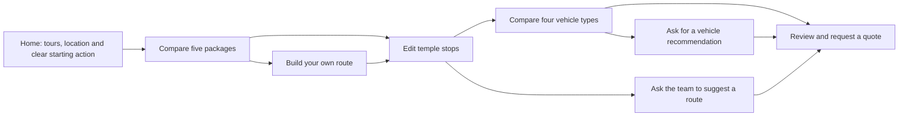

# Heavenly: a clear pilgrimage-planning journey

The experience uses warm ivory, restrained burgundy, muted brass, a temple seal and generous serif typography. The heritage character comes from visual choices, not invented claims about the business's age or history.

## Information architecture

All four planning sections remain reachable directly through the persistent step navigation. The numbered steps explain the journey without locking visitors into a wizard. Contact by telephone is available from the header, homepage, booking summary and footer.

| Visitor question | Where the answer appears |
| --- | --- |
| What does this business offer? | Homepage: private Tirupati and South India temple travel |
| Where are the packages? | Explicit homepage CTA, main navigation and first planning step |
| What are the five packages? | Visible package cards with names on the images, route stops, suitability and estimates |
| What does a package cover? | Expandable coverage within each package, before selection |
| How do I change the temples? | Dedicated stop editor with tick/untick guidance, extras and reset |
| What changed the estimate? | Itemized vehicle starting base plus selected stop fees |
| Which vehicles can I choose? | All four vehicle types shown together, with starting bases and suitability |
| What if I don't know what to pick? | Own-route option, route help, vehicle recommendation and direct contact |
| Will this book or charge me? | Homepage instructions, quote section and FAQ explain the enquiry-only flow |
| Are tickets guaranteed? | Explicit darshan availability explanation in the FAQ |

The landscape collection and brand story follow the quote section. The gallery is optional and collapsed initially; it never separates the planning steps.

## Interaction and state

`src/app.js` holds selected tour, vehicle, customization progress and a set of stops per route. `updateSummary()` derives estimates, selection badges, the trip review and the mobile continuation action from the same state. The existing price constants stay in `src/tours.js`.

Changing a package or vehicle keeps entered travel details. Separate session-storage records retain trip preferences and the travel form for the current browser session. Filtering packages does not erase the selected trip. The site does not add a backend, collect enquiries on a server or perform bookings.

The editor provides a reset action. Empty routes show an inline explanation with an actionable route-help option; undecided visitors can still ask for a quote. Every primary action states its next destination. On mobile the quote summary starts collapsed, so the required fields are easier to reach; its estimate and selection count remain visible.

The final form uses visible labels, native date input, future/current date validation, flexible dates and a bounded traveller count. It builds a readable WhatsApp draft with separate lines. The visitor decides whether to send that draft. No message is automatically sent.

## Motion and performance

The former hero switched from a 24 fps 720p film to a 12 fps, 960×540 frame sequence while scrolling. On-demand images could arrive out of order, and integer crop positions in the source edit could visibly jitter.

The replacement uses a twenty-second film rendered with continuous floating-point transforms from the original image. The scale varies slowly from 1.012 to 1.032; position and velocity meet at the loop boundary. Desktop playback is 1920×1080 at 60 fps. The mobile version retains 1920×1080 at a consistent 30 fps with a 3 Mbps cap to reduce decoding and network pressure. Both use progressive MP4 metadata at the front of the file.

There is no scroll seeking, frame canvas, image-sequence fetching or scroll-based playback handoff. The browser plays the film natively. It pauses offscreen and when the tab is hidden. The pause button preserves the current frame. Reduced-motion and data-saving preferences use the poster initially. Essential content is immediately visible, with no delayed entrance animation.

The archived generated images, clips and extracted frames remain in the project; the revised homepage no longer downloads the scroll-frame sequence.

## Validation

`qa_journey.py` writes REA scenarios for real desktop/mobile interactions and two browser harnesses. Results and screenshots are kept in `output/rea-qa/journey-v2/`. The final functional harness covers comparison, filtering, custom routes, stop editing, estimates, recommendations, saved details, draft formatting, dialogs, playback continuity and layout widths from 320 through 1440 pixels. The mobile playback harness measures decoded/dropped frames over a separate steady sample.

REA can retain complete requested page states while reporting `cleanup_incomplete` on process shutdown. Such results remain explicitly partial tool observations. Checks and screenshots are interpreted from captured states, without claiming clean REA shutdown or guaranteed frame rates on every visitor's device.

Final local verification: **65/65 checks passed**. The separate mobile playback sample decoded **99 frames over 3.312 seconds with zero dropped frames**, at 1920×1080. WhatsApp line-break formatting also passed. See `output/rea-qa/journey-v2/verification-summary.json`.
